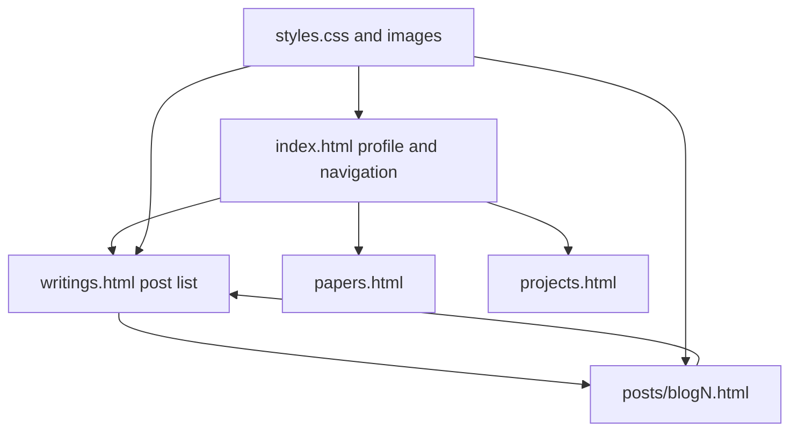

# Personal Website, explained for humans

This is a hand-written static portfolio and blog, served at www.scipolitic.com. The browser loads HTML pages, a shared stylesheet and images directly. There is no JavaScript application, backend, database or build step in the site source.

Read `index.html` first. It holds the About Me profile, the profile links and ordinary links to the other pages. `papers.html` lists papers newest first, one table row each, with a title link, authors, venue and a short summary. `projects.html` lists projects the same way, with a date and a row of GitHub, demo, paper or dataset links under each one. `writings.html` lists the blog posts by hand in a table. Each page in `posts/` contains its own article markup and a back link. The posts run from blog1 to blog21 with no blog13, which was renamed to blog14 to bust a cache. `styles.css` defines the shared visual classes, and the main pages also use inline styles. `images/` supplies the profile photo and the article illustrations. `CNAME` supplies the custom domain setting for hosting.

A new post needs both its HTML file and a listing row in `writings.html`, because nothing discovers or indexes posts automatically. `feed.xml` is an RSS feed of every post with its full text, used to import the posts into Substack. It is generated, not hand-written: after adding or editing a post, run `python3 tools/build_feed.py .` from the repo root and commit the new `feed.xml`. Relative paths in a post point one directory up to shared assets. A new paper or project is one new table row at the top of its page, copied from the row below it.

The site is public, so its copy holds only facts the owner has made public, and it links only public pages and public repos. `CLAUDE.md` lists what must never go on the site.

The output is the rendered website. Broken paths produce missing images or missing pages, and there is no error handler. Pushing to the `main` branch publishes the site through GitHub Pages. There are no code functions to annotate. To understand a change, follow one homepage link to a listing, then a post, then its stylesheet and image references.
